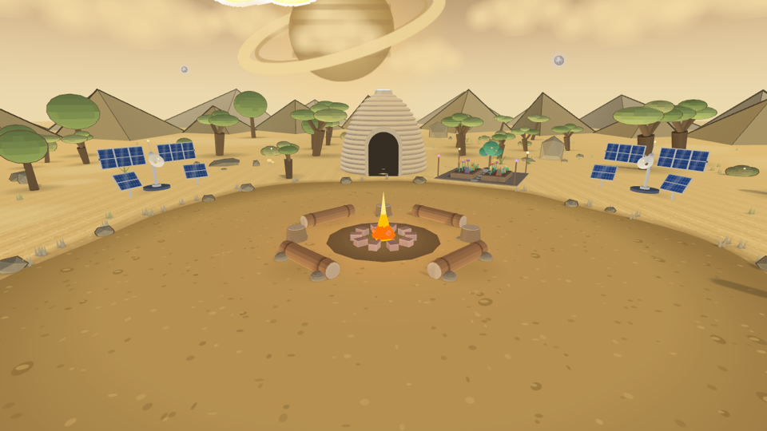

# Skyke3D nativo (Rust + Bevy + Rhai)

Reconstrução do [Skyke3D](https://github.com/Noturno-Strange/skyke3d) como jogo nativo para Linux e Windows.
Não é um jogo novo: os mundos, a arte toon low-poly, a interface e a experiência social são os do Skyke3D original,
agora sobre Rust, Bevy (WGPU/Vulkan), shaders WGSL e scripts Rhai.

> **Estado:** em desenvolvimento. Os 6 mundos originais já abrem no cliente nativo e o cliente entra em salas do
> servidor Node.js atual junto com jogadores do navegador. Interface, avatares personalizados, gameplay, voz e o
> servidor Rust ainda estão sendo migrados. Detalhes e medições em [docs/estado-da-migracao.md](docs/estado-da-migracao.md).



## Rodar

Requisitos: Rust 1.85+ e, no Linux, `libasound2-dev libudev-dev libwayland-dev libxkbcommon-dev libfontconfig1-dev` (ou equivalentes).

```bash
cargo run --release -p sky-client --bin skyke3d                         # tela inicial
cargo run --release -p sky-client --bin skyke3d -- --world cerron --explore   # direto no mundo, sem rede
```

| Tecla | Ação |
| --- | --- |
| W A S D / setas | andar |
| E / F | pular / sentar (perto de um assento) |
| botão direito | arrastar gira a câmera; clique alterna câmera padrão / de frente |
| Enter / Esc | abrir e enviar o chat / voltar ao jogo |

### Servidor

O servidor também é Rust (`skyke3d-server`), no estilo de um servidor de Minecraft: `server.properties`, pasta
`data/` e console com comandos. Detalhes em [docs/servidor.md](docs/servidor.md).

```bash
cargo run --release -p sky-server -- --dir /caminho/da/pasta   # a pasta precisa de web/ (o cliente do navegador)
```

Entrar no servidor do jogo (o Rust ou o Node.js original, com o mesmo protocolo):

```bash
cargo run --release -p sky-client --bin skyke3d -- --server http://localhost:3000 --name Ana --world amazora --bots 3
cargo run --release -p sky-client --bin skyke3d -- --server http://localhost:3000 --name Bia --join ABCDE-FGHJK
```

Mundos: `amazora`, `cerron`, `atlanthia`, `caatara`, `panthara`, `pamphora`.

## Estrutura

```text
crates/
  shared/       tipos e constantes comuns (mundos, ids de ator, códigos de sala, limites)
  protocol/     mensagens JSON e pacotes binários (estado 5 Hz, voz) compatíveis com o servidor Node.js
  security/     ticket de admissão e provas de trabalho, limitador de frequência, limpeza de texto
  identity/     identidade sem conta: chaves ECDSA P-256, ids derivados, cargas assinadas
  scripting/    Rhai em sandbox (limites, cache de compilação, recarga)
  persistence/  gravação atômica e perfis online/offline separados
  networking/   cliente Tokio: ticket → WebSocket → identidade → sala
  avatars/      visual do avatar como no navegador: paletas, rosto por pixel, cores do cabelo, corpo em tubos e faixas
  ui/           tema do original (escuro, claro, alto contraste), fonte Manrope, painel, botão, campo de texto
  rendering/    material toon WGSL que reproduz o MeshToonMaterial do original, mipmaps
  world/        carrega os mundos exportados (GLB + world.json), troca materiais, sprites
  client/       o jogo (binário `skyke3d`)
  server/       o servidor (binário `skyke3d-server`): salas, identidade, gameplay, voz, mídia e moderação
tools/
  asset-exporter/     exporta mundos e avatar do cliente web original para GLB + metadados + capturas
  visual-comparator/  compara capturas nativas com as de referência (PSNR, mapa de diferenças)
  server-compat/      roda a suíte de testes do servidor Node.js original contra o servidor Rust
assets/  worlds/, avatars/, shaders/, fonts/
data/    catalogs/catalog.json (catálogo do original: paletas, itens, receitas, plantas, remédios)
docs/    auditoria do original, protocolo, estado da migração, Rhai, ferramentas
```

Os crates planejados na especificação (`server`, `engine`, `physics`, `gameplay`, `avatars`, `animation`, `audio`,
`voice`, `media`, `ui`) entram no workspace quando tiverem código e testes, para o projeto não carregar módulos
vazios.

## Desenvolvimento

```bash
cargo fmt --all --check
cargo clippy --workspace --all-targets -- -D warnings
cargo test --workspace
```

Regras do projeto: Rust seguro (`unsafe_code = "forbid"` no workspace), dependências auditadas com `cargo deny`
(`deny.toml`), nada de `unwrap` fora de testes, mensagens e arquivos tratados como dados não confiáveis.

## Documentação

* [Auditoria do original](docs/auditoria/visao-geral.md)
* [Protocolo](docs/auditoria/protocolo.md)
* [Estado da migração e fidelidade visual](docs/estado-da-migracao.md)
* [Scripts Rhai](docs/rhai.md)
* [Ferramentas](docs/ferramentas.md)

## Licença e créditos

GPL-3.0-only, como o Skyke3D original (`LICENSE`). Os mundos e o avatar em `assets/` são exportados do Skyke3D
original (© Noturno-Strange, GPL-3.0-only). Terceiros: [THIRD-PARTY.md](THIRD-PARTY.md).
